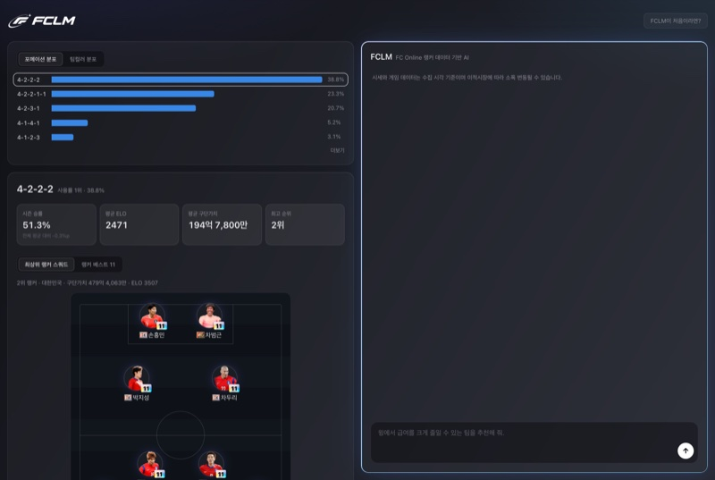
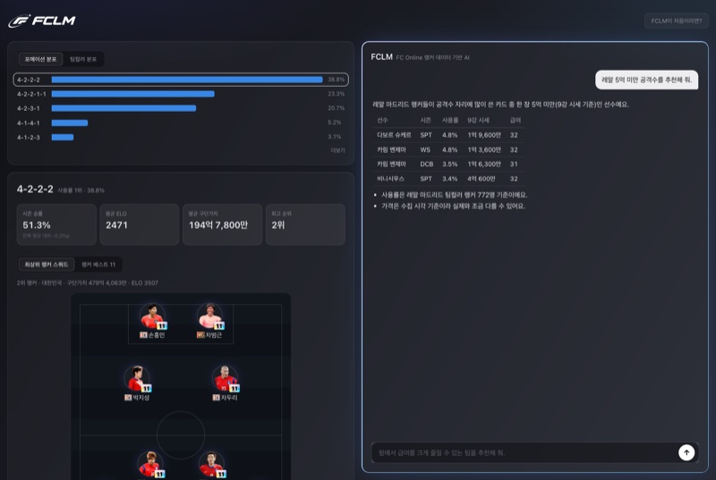
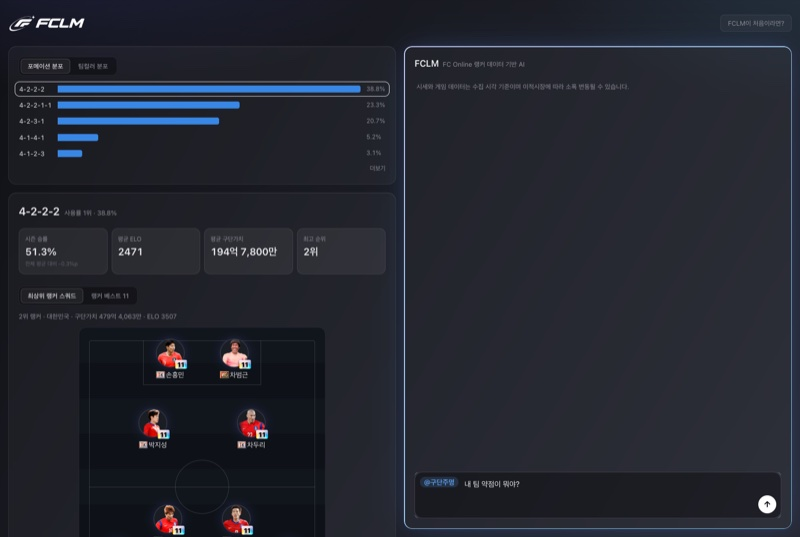
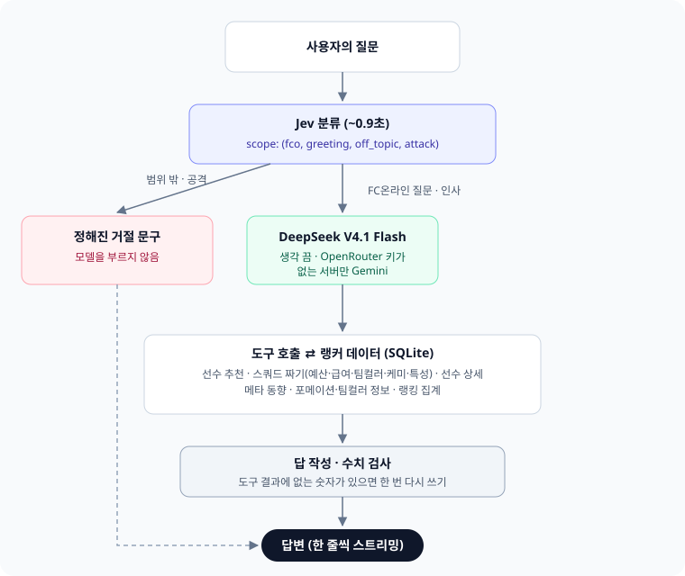

# FCLM

FC온라인 랭커 데이터로 선수 추천과 스쿼드 구성을 돕는 AI 챗봇입니다. 랭킹 상위 랭커들이 실제로 쓰는 선수·카드·포메이션을 매일 모아 데이터로 답합니다.

**사이트: <https://fclm.onrender.com>** · 자세한 사용법은 [가이드](https://fclm.onrender.com/guide)

## 화면

- **왼쪽**: 랭커들의 포메이션·팀컬러 통계.
- **오른쪽**: 챗봇.
- 넓은 화면에서는 두 패널 사이 손잡이를 왼쪽으로 끌어 챗봇을 넓힐 수 있습니다(왼쪽은 스쿼드 그림이 들어가는 폭까지). 휴대폰에서는 챗봇이 먼저, 통계가 아래에 나옵니다.

## 랭커 통계 (왼쪽 패널)

위쪽 전환 버튼으로 **포메이션 분포**와 **팀컬러 분포**를 오갑니다.

- **분포 막대**: 랭킹 상위 랭커들이 쓰는 비율 순서. 처음엔 5위까지, **더보기**를 누르면 더 보입니다.
- 줄을 누르면 아래에 그 포메이션(팀컬러)의 상세가 열립니다.
  - **요약 칸**: 시즌 승률(전체 평균 대비), 평균 ELO, 평균 구단가치, 최고 순위
  - **스쿼드**: 그것을 쓰는 최상위 랭커의 실제 선발 11명과, 랭커들이 자리별로 가장 많이 쓴 **랭커 베스트 11**
  - **상대 포메이션별 전적**: 승·무·패 (포메이션만)
  - **많이 쓰는 팀컬러 / 포메이션**과 **순위 구간별 사용 비율**

## 질문하기

질문을 쓰고 Enter 또는 보내기 버튼을 누르면 모델이 질문에 답합니다.

| 종류 | 예시 |
|---|---|
| 선수 추천 | 레알 5억 미만 공격수를 추천해 줘. · 가성비 좋은 볼란치를 추천해 줘. |
| 신규특성 | 라브가 달린 뮌헨 윙어를 추천해 줘. · 리버풀 수비수 중에 체이서가 달린 선수를 추천해 줘. |
| 스쿼드 | 리버풀 4-2-3-1 스쿼드를 100억 안에서 짜 줘. · 즐라탄을 넣은 바르샤 스쿼드를 20억 미만으로 짜 줘. |
| 비교·대체 | 라이스랑 수비멘디를 비교해 줘. · 파리 생제르맹에서 음바페 대신 쓸 싼 스트라이커는 누구야? |
| 메타 | 요즘 뜨는 팀컬러는 뭐야? · 4-2-3-1이랑 4-2-2-1-1 중에 어느 쪽 성적이 좋아? |

Shift+Enter는 줄바꿈, 답하는 동안 보내기 버튼은 ■ 정지가 됩니다. 입력창이 비어 있으면 예시 질문이 흐리게 보이고, Tab을 누르면 채워집니다.

## 내 팀으로 묻기 (@구단주명 · #스쿼드 피드 ID)

빈 입력창에 `@` → 구단주명 입력 → →(또는 Enter). 그 유저의 **최근 공식·친선경기 선발 11명**을 불러옵니다. 칸 밖을 누르면 취소.

입력창 앞에 붙은 `@구단주명` 뒤로 질문을 이어 쓰면, 그 팀(선수·강화·급여·시세·팀컬러)이 질문과 함께 전달됩니다.

- 이어지는 질문도 해당 팀을 기억합니다. ✕나 빈 입력창에서 Backspace로 뗍니다.
- 최근 공식·친선경기가 없으면 불러올 수 없고, 최근 경기 선발출전한 인원을 기준으로 합니다.

**#스쿼드 피드 ID**: 빈 입력창에 `#`을 치고 15자리 ID(예: `KQ221UD8K7R53LN`)를 넣으면, 스쿼드메이커에 공개된 피드의 선발 11명을 같은 방식으로 불러옵니다.

## 스쿼드메이커로 내보내기

스쿼드를 짜 준 답에는 **스쿼드메이커로 내보내기 ↗** 버튼이 붙습니다. 누르면 안내 페이지(`/send`)가 열리고, 북마클릿으로 넥슨 스쿼드메이커 **내 보관함**에 저장하는 3단계를 알려 줍니다. FCLM은 넥슨 로그인 정보를 보지 않습니다.

## 명령어

`/`를 치면 목록이 뜹니다. 마우스를 올리거나 ↑↓로 고르면 설명이 보이고, 고르면 입력창에 채워져 Enter로 실행합니다. `/model`은 고르면 바로 모델 선택창이 뜹니다.

| 명령어 | 하는 일 |
|---|---|
| `/model` | 모델 선택창: GPT-6 Luna(기본) · Gemini 3.5 Flash · DeepSeek V4.1 Flash. 새로고침 전까지 계속 적용 |
| `/trace` | 모델의 사고과정을 답 위에 표시: 생각함 · 도구 이름(예: 스쿼드 구성함) · 수치 재검토함 · 답변 작성함 (거절된 질문은 답변 거절됨). 머리글에 걸린 초가 보이고, 한 번 더 치면 끔 |
| `/help` | 가이드의 명령어 페이지를 새 탭에 |

## 답이 만들어지는 과정

- **Jev**(가벼운 분류 모델)가 먼저 질문을 나눕니다. 범위 밖이거나 지시를 바꾸려는 입력은 모델 없이 거절합니다.
- 기본 모델 **GPT-6 Luna**는 생각을 켜고 답합니다. 팀을 붙이지 않은 세션의 첫 질문이 Jev가 보기에 단순 조회일 때만 생각을 끕니다. OpenRouter 키가 없는 서버는 Gemini(Flash-Lite → 3.5 Flash)로 답합니다.
- 모델은 숫자를 지어내지 않고 랭커 DB를 조회하는 **도구 결과로만** 답합니다. 결과에 없는 숫자가 있으면 한 번 다시 씁니다(수치 재검토). 답은 한 줄씩 스트리밍됩니다.

## 데이터 기준

- 공식경기(1vs1) 랭킹 상위 10,000명의 순위·팀컬러·포메이션·전적, 그 랭커들이 직전 공식경기에 낸 선발 명단, 카드 시세·급여·능력치(1강 기준).
- 매일 0시 30분(한국 시간)쯤 갱신. 시세는 수집 시각 기준이라 실제와 조금 다를 수 있습니다.

## Tech Stack

| Area | Stack |
|---|---|
| Backend | Python 3.12, FastAPI + Uvicorn (NDJSON streaming) |
| Data | SQLite, stored in a private Hugging Face dataset |
| Collection | NEXON Open API, FC Online Data Center scraping (httpx + selectolax) |
| AI | GPT-6 Luna (default, OpenRouter), Gemini 3.5 Flash-Lite / Flash (google-genai, fallback and /model), DeepSeek V4.1 Flash (OpenRouter, /model); DB queries via tool calling |
| Question routing | Jev (OpenRouter Decisions API) |
| Frontend | Vanilla HTML / CSS / JS (ES modules), marked + DOMPurify, border-beam, thinking-orbs |
| Automation / Deploy | GitHub Actions (daily collection), Render |
| Testing | pytest, eval script comparing models on question sets |
